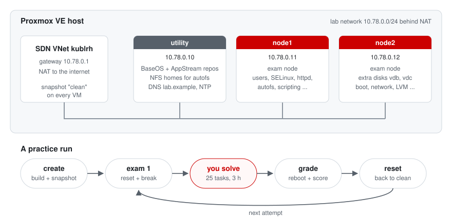

# RHCSA Practice Lab for Proxmox VE

[](https://github.com/kubl443/rhcsa-lab/actions/workflows/shellcheck.yml)

-0F4266?logo=almalinux&logoColor=white)


A hands-on practice lab for the **RHCSA exam (EX200, RHEL 10)**. One script builds the lab
on a Proxmox VE host, breaks the machines on purpose for a mock exam, grades your work after a
reboot, and resets everything to a clean snapshot for the next attempt.

<p align="center">
  
</p>

## Features

- **One command per step:** `create`, `exam`, `grade`, `reset`, `destroy`
- **Exam-like setup:** a utility server with package repos, NFS, DNS and NTP, plus two exam
  nodes with extra disks (`/dev/vdb`, `/dev/vdc`), like in the real exam
- **Real troubleshooting:** the mock exam starts with broken machines, e.g. an unknown root
  password, a wrong network configuration, missing repos and SELinux problems
- **Automatic grading:** the exam nodes are rebooted first, so only persistent configuration
  counts. Every task is checked on the machines and scored in points.
- **Clean resets in seconds:** every VM has a snapshot of the clean state
- **Safe on your host:** it only touches VMs and network objects it created itself
- **No subscription needed:** AlmaLinux 10 is built from the same sources as RHEL 10

Tested end to end on Proxmox VE 9: build, unsolved exam (0/300), solved exam (300/300 after
the reboot), reset and cleanup.

## Quick start

On the Proxmox host, as root:

```bash
git clone https://github.com/kubl443/rhcsa-lab.git
cd rhcsa-lab

bash rhcsa-lab.sh create      # build the lab (about 10 minutes)
bash rhcsa-lab.sh exam 1      # reset, break things, show the tasks
# ... solve the tasks ...
bash rhcsa-lab.sh grade       # reboot node1 + node2, then check and score
bash rhcsa-lab.sh reset       # back to the clean snapshot
bash rhcsa-lab.sh destroy     # remove the lab completely
```

`bash rhcsa-lab.sh exam` lists all mock exams. The tasks of exam 1 are in
[`exams/exam1/tasks.md`](exams/exam1/tasks.md). Avoid the other files of an exam until you
have done it: they contain the answers.

## The lab

| VM | Address | Role |
|---|---|---|
| `utility.lab.example` | 10.78.0.10 | package repos (BaseOS, AppStream), NFS, DNS, NTP |
| `node1.lab.example` | 10.78.0.11 | exam node |
| `node2.lab.example` | 10.78.0.12 | exam node with two extra disks |

- Login on all VMs: `root` / `redhat`
- The repos are served as `http://utility.lab.example/repo/BaseOS` and `/repo/AppStream`
- Use the VM console in the Proxmox web UI for tasks like resetting the root password

## Mock exam 1

25 tasks, 3 hours, 300 points, 210 to pass, based on the public
[EX200 objectives](https://www.redhat.com/en/services/training/ex200-red-hat-certified-system-administrator-rhcsa-exam):

| Area | Tasks |
|---|---|
| Boot and recovery | reset an unknown root password, tuned profile, persistent journal, process priority |
| Networking | static IPv4, gateway, DNS and hostname, firewall for a web server |
| Software | configure BaseOS and AppStream repositories on both nodes |
| Users and groups | users, groups, sudo, password aging, default umask |
| Storage | GPT partitions, LVM with a custom extent size, grow an LV with its filesystem, swap |
| File systems | mount by UUID, autofs with NFS home directories, setgid shared directory |
| Security | SELinux enforcing, port labels and file contexts, SSH key authentication |
| Services and scheduling | chrony client, cron job, systemd timer, Apache on a custom port |
| Essential tools | find, grep, tar with bzip2, a Bash script with arguments and exit codes |

## Grading

The grader logs in to the VMs and checks the result, not the commands you used. Before that it
reboots node1 and node2, because in the exam everything has to survive a reboot.

```text
==> Grading exam1, 164 minutes after the start
==> Rebooting node1 node2 first (everything has to survive a reboot, like in the exam)

  12. node1: SELinux
    ✓ 10/10  SELinux is enforcing, also after a reboot

  13. node1: web server
    ✓ 10/10  http://node1.lab.example:82/ shows the page (tested from utility)
    ✗  0/5   httpd starts at boot and serves the page with SELinux enforcing

  Score: 255 of 300 points (85%), passing needs 70%  ->  PASSED
```

Results are saved in `/root/kubl-labs/rhcsa/results/`. Use `grade --no-reboot` to skip the
reboot while you work.

## Requirements

- Proxmox VE 8.1 or newer (uses Proxmox SDN), run as root on the host
- Storage with snapshot support: LVM-thin, ZFS or a directory storage (qcow2)
- About 7 GB free RAM (the VMs use 5.5 GB)
- A CPU with x86-64-v3 support (most CPUs since 2015, required by RHEL 10)
- Internet access from the host

## Connecting from your PC

The lab network sits behind NAT on the Proxmox host. Add this to `~/.ssh/config` on your PC
(on Windows `C:\Users\<you>\.ssh\config`) and put in the address of your Proxmox host:

```text
Host proxmox
    HostName <proxmox-host>
    User root

Host node1
    HostName 10.78.0.11
    User root
    ProxyJump proxmox

Host node2
    HostName 10.78.0.12
    User root
    ProxyJump proxmox
```

Then `ssh node1` and `ssh node2` work directly.

## Settings

Set them as environment variables, e.g. `STORAGE=local-zfs bash rhcsa-lab.sh create`:

| Variable | Default | Meaning |
|---|---|---|
| `STORAGE` | auto | Proxmox storage for the VM disks |
| `NET` | `10.78.0` | lab network (`/24`) |
| `UTIL_MEM` / `NODE_MEM` | `1536` / `2048` | memory per VM in MB |
| `CORES` | `2` | CPU cores per VM |

## What it changes on the host

- A Proxmox SDN zone `kubl` (type simple, with NAT) and a VNet `kublrh`. If a VNet with that
  name already exists, the script stops instead of using it.
- Three VMs tagged `kubl-labs`. `destroy` only deletes VMs with the lab's names **and** that tag.
- IP forwarding is enabled (`/etc/sysctl.d/99-kubl-labs.conf`)
- `/root/kubl-labs`: the cloud image, an SSH key for the script, logs and grading results

`destroy` removes everything except `/root/kubl-labs`. Note that applying the SDN
configuration also applies other pending SDN changes on the host.

The lab uses simple passwords on purpose. The VMs are only reachable through the Proxmox host.

## Troubleshooting

**Something failed:** the script stops and prints the last lines of the log. All logs are in
`/root/kubl-labs/rhcsa/logs/`. To start over: `destroy`, then `create`.

**The VMs can't reach the internet** (`Could not resolve host` during `create`): a firewall on
the Proxmox host drops forwarded traffic, for example an nftables `forward` chain with
`policy drop`. Allow forwarding for the lab network:

```bash
nft insert rule inet <table> forward iifname "vmbr0" oifname "kublrh" ct state established,related accept
nft insert rule inet <table> forward iifname "kublrh" oifname "vmbr0" accept
```

**The storage can't take snapshots:** plain LVM doesn't support them. Choose another storage
with `STORAGE=name`.

## Writing your own mock exam

An exam is a folder in `exams/` with four files:

| File | Content |
|---|---|
| `tasks.md` | the task sheet, the first line is the title |
| `setup.sh` | brings the lab into the starting state |
| `grade.sh` | one check per result |
| `solutions.md` | example solutions |

`setup.sh` runs commands as root on a node:

```bash
run node2 <<'EOF'
systemctl disable --now chronyd
EOF
```

`grade.sh` checks results. Each check has points, a node, a description and code that runs as
root on the node. Every line has to succeed for the points:

```bash
task "4. Time"
check 10 node2 "chronyd runs and starts at boot" <<'EOF'
systemctl is-enabled --quiet chronyd
systemctl is-active --quiet chronyd
EOF
```

## Project structure

```text
rhcsa-lab.sh          entry point: settings, VM setup, the five commands
lib/lab.sh            Proxmox network, VMs, snapshots, exam runner and grader
exams/exam1/          mock exam 1: tasks, setup, grader, solutions
docs/                 images for this README
```

## Disclaimer

This project is not affiliated with or endorsed by Red Hat. The tasks are based only on the
public exam objectives, not on real exam content. Red Hat, RHEL and RHCSA are trademarks of
Red Hat, Inc.

## License

[MIT](LICENSE) © Konstantin Ubl
